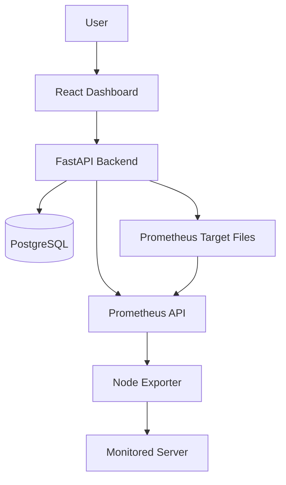

# ServerPulse

**Infrastructure Monitoring Platform**

ServerPulse is a self-hosted infrastructure monitoring application built with FastAPI, React, PostgreSQL and Prometheus. It provides a dashboard for viewing server inventory, infrastructure metrics and historical performance data.

## Current Features

- Server inventory backed by PostgreSQL.
- Register, list, retrieve, update and delete servers through REST APIs.
- Enable or disable monitoring for registered servers.
- Node Exporter connectivity checks.
- Dynamic Prometheus file-based service discovery.
- CPU, memory, disk and server availability metric queries.
- Historical metric visualization using Prometheus query APIs.
- Interactive dashboard with server, metric and time-range filters.
- Automatic dashboard data refresh.
- Docker Compose-based local deployment.

## Architecture



### Technology Stack

| Component | Technology |
|---|---|
| Frontend | React, TypeScript, Vite |
| Charts | Recharts |
| Backend | Python, FastAPI |
| Database | PostgreSQL |
| Metrics collection | Prometheus |
| Server metrics | Node Exporter |
| HTTP client | Axios / HTTPX |
| Containers | Docker, Docker Compose |

## Project Structure

```text
serverpulse/
├── backend/
│   ├── app/
│   │   ├── api/
│   │   ├── core/
│   │   ├── models/
│   │   └── schemas/
│   ├── tests/
│   ├── Dockerfile
│   └── requirements.txt
├── frontend/
│   └── src/
├── prometheus/
│   ├── prometheus.yml
│   └── targets/
├── docker-compose.yml
├── .env.example
├── .gitignore
└── README.md
```

## Getting Started

### Prerequisites

- Git
- Docker Desktop or Docker Engine
- Docker Compose v2
- Node.js and npm (for frontend development outside Docker)

### 1. Clone the repository

```bash
git clone https://github.com/dba-ayaan/serverpulse.git
cd serverpulse
```

### 2. Configure environment variables

```bash
cp .env.example .env
```

Edit `.env` and set a secure local PostgreSQL password.

Do not commit `.env` or publish credentials.

### 3. Start infrastructure and backend

```bash
docker compose up -d --build
```

Initialize the database:

```bash
docker compose exec api python -m app.init_db
```

Check service status:

```bash
docker compose ps
```

### 4. Open the services

| Service | Local URL |
|---|---|
| React dashboard | http://localhost:5173 |
| FastAPI Swagger | http://localhost:8000/docs |
| API health | http://localhost:8000/health |
| Prometheus | http://localhost:9090 |
| Node Exporter | http://localhost:9100/metrics |

### 5. Start the frontend

Open another terminal:

```bash
cd frontend
npm install
npm run dev
```

Open http://localhost:5173.

The frontend uses `VITE_API_BASE_URL` from `frontend/.env`, configured for the local API at `http://localhost:8000`.

## Register a Monitoring Target

Open the FastAPI Swagger interface:

http://localhost:8000/docs

Use `POST /api/v1/servers/` with this example payload:

```json
{
  "name": "Docker Linux VM",
  "hostname": "node-exporter",
  "environment": "DEV",
  "exporter_port": 9100
}
```

This example uses the Node Exporter container hostname on the Docker Compose network.

After registration, the backend updates the Prometheus file-based discovery target configuration.

Prometheus periodically reloads the target file according to its configured refresh interval.

## API Reference

Base URL: `http://localhost:8000`

| Method | Endpoint | Description |
|---|---|---|
| GET | `/health` | API health |
| GET | `/ready` | Readiness check |
| GET | `/api/v1/servers/` | List servers |
| POST | `/api/v1/servers/` | Register server |
| GET | `/api/v1/servers/{id}` | Get server |
| PUT | `/api/v1/servers/{id}` | Update server |
| PATCH | `/api/v1/servers/{id}/status` | Enable or disable monitoring |
| GET | `/api/v1/servers/{id}/check` | Check Node Exporter connectivity |
| DELETE | `/api/v1/servers/{id}` | Delete server |
| GET | `/api/v1/metrics/summary` | Current metric summary |
| GET | `/api/v1/metrics/{metric}` | Query an individual metric |
| GET | `/api/v1/metrics/history/{metric}` | Historical metric data |

Interactive API documentation is available at `/docs`.

## Running Tests

Create and activate a Python virtual environment if one does not already exist:

```bash
python3.12 -m venv .venv
source .venv/bin/activate
```

Install backend dependencies:

```bash
pip install -r backend/requirements.txt
```

Run tests:

```bash
PYTHONPATH=backend pytest backend/tests -v
```

Build the frontend:

```bash
cd frontend
npm install
npm run build
```

## Current Development Status

| Capability | Status |
|---|---|
| FastAPI backend | Implemented |
| PostgreSQL server inventory | Implemented |
| Prometheus integration | Implemented |
| Dynamic target discovery | Implemented |
| Node Exporter connectivity check | Implemented |
| CPU and memory metrics | Implemented |
| Historical metric dashboard | Implemented |
| Server management REST APIs | Implemented |
| Dedicated server management UI | Planned |
| Alert rules and alert history | Planned |
| Authentication and RBAC | Planned |
| CI/CD with GitHub Actions | Planned |
| Production deployment | Planned |

## Known Limitations

- The current disk metric query uses a Docker Desktop test filesystem. Physical Linux filesystem selection and production disk monitoring still need implementation.
- The supplied Node Exporter container is intended for local development and testing.
- The application has not yet implemented authentication or role-based authorization.
- The connectivity-check endpoint is intended for trusted development environments, not unrestricted public access.
- Production deployment, security hardening and alert management are not yet complete.

## Security Notes

- Never commit `.env`, passwords, tokens, private keys or sensitive infrastructure details.
- Do not expose the PostgreSQL or Node Exporter ports publicly.
- Restrict API access to trusted networks until authentication, authorization and network-target validation are implemented.
- Use secure credentials and HTTPS in production.

## License

No license file has been added yet. Reuse and redistribution permissions have not been specified.
